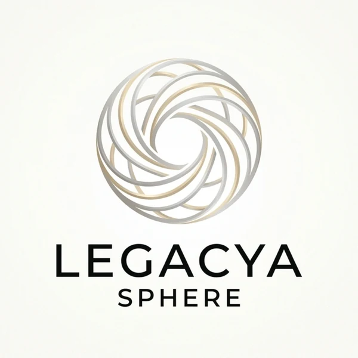

<div align="center">

<br />



<br /><br />

# Legacya Sphere · Brand, Digital Experience & Creative Studio

### Building Brands. Creating Experiences. Shaping What's Next.

*Digital Experiences & Business Systems · Advertising & Campaign Assets · Cinematic Video & Visual Production*

<br />

[](https://legacya-portofolio.vercel.app)
[](https://legacyasphere-id.github.io/Legacya-Portofolio/)
[](https://react.dev)
[](https://www.typescriptlang.org)
[](https://vitejs.dev)

<br />

</div>

---

## Overview

The official B2B studio website and portfolio for **Legacya Sphere**, a brand, digital experience, and creative production studio based in Bekasi, Indonesia.

Designed for business owners, consumer brands, and growing companies, the website communicates Legacya Sphere's capabilities in clear, outcome-driven business language without technical jargon:

1. **Digital Experiences & Business Systems**: Business websites, company profiles, customer portals, custom internal tools, and intelligent workflow automation.
2. **Advertising & Campaign Assets**: Campaign key visuals, product photography direction, social media advertising assets, and launch creative suites.
3. **Cinematic Video & Visual Production**: Animated product commercials, luxury fragrance and culinary films, short-form campaign reels, and visual storytelling.

---

## What Was Updated in This Release

* **Expanded B2B Studio Positioning**: Repositioned Legacya Sphere from a technical developer portfolio into a complete B2B studio covering Digital Systems, Advertising Visuals, and Cinematic Video Production.
* **Dedicated Creative & Video Showcase (`CreativeWorkSection`)**: Added 6 studio productions across two filterable categories:
  * **Advertising & Campaign Assets**:
    * *Hanasui Cosmetics: Tactile Product & Shade Campaign* (`public/creative-work/hanasui-product-ad.webp`)
    * *Flame-Grilled Burger: Culinary Campaign Key Visual* (`public/creative-work/burger-campaign.webp`)
    * *LATE Black Cold Brew: Dynamic Social & Launch Visual* (`public/creative-work/cold-brew-campaign.webp`)
  * **Cinematic Video & Visual Production**:
    * *Hanasui Lip Cream: 3D Liquid Ribbon & Macro Commercial* (`public/creative-work/cosmetic-commercial.mp4`)
    * *Ethereal Bloom Fragrance: Botanical Splash & Flacon Film* (`public/creative-work/perfume-commercial.mp4`)
    * *Artisanal Cheeseburger: Slow-Motion Culinary Commercial* (`public/creative-work/burger-commercial.mp4`)
* **Global Edge CDN & Low-Bandwidth Optimization**: All campaign visuals and video poster frames are compressed into lightweight `.webp` (`15 KB` to `86 KB`), MP4 videos are encoded with `faststart` streaming headers and lazy-loaded via `IntersectionObserver` + Network Information API awareness, and `vercel.json` serves immutable Edge cache headers globally.
* **Customer-Friendly Digital Systems Showcase (`WorkSection`)**: Rewrote all four live business system case studies (*InventoryOS*, *AI-CV Screening*, *BrightPath Dental*, *Legacya POS*) around business challenges, operational solutions, and customer value.
* **New Studio Introduction & Why Legacya Sections**: Replaced developer-centric tech stack marquees with `StudioIntroSection` and `WhyLegacyaSection`, highlighting practical advantages of partnering with one studio across digital and creative execution.
* **Custom Project Inquiry & Scope Builder (`CTASection`)**: Replaced fixed pricing tiers with an interactive project scope builder that lets prospective clients choose a service pillar, objective, and timeline, then send a structured project brief directly via WhatsApp or Email.
* **Editorial Copy & Typography Audit**: Removed technical acronyms, framework jargon, and em-dashes from all customer-facing pages, backed by automated unit tests (`src/core/inquiry.test.ts`).

---

## Design System

A calm warm-stone canvas paired with Legacya Sphere's signature deep architectural blue:

| Token | Hex | Purpose |
|-------|-----|---------|
| `bg` | `#F5F0E8` | Warm stone page canvas |
| `surface` | `#FAF7F2` | Elevated cards and content containers |
| `raised` | `#F0EADF` | Subtle section and pill elevation |
| `border` | `#E5DDD0` | Hairline dividers, cards, inputs |
| `text` | `#181818` | Headlines and primary copy |
| `muted` | `#66625D` | Supporting descriptions |
| `dim` | `#9A958C` | Metadata and labels |
| `blue` | `#5E7EBE` | Secondary blue accent and highlights |
| `blue-deep` | `#2F4F7F` | Primary authority blue for actions, headlines, and badges |
| `blue-dark` | `#26416B` | Hover state for deep blue |

---

## Website Structure

Composed in order by `src/App.tsx`:

| # | Section | Component | Description |
|---|---------|-----------|-------------|
| 0 | **Navigation** | `SiteNav` | Fixed glass header featuring the Legacya Sphere emblem, wordmark, section links, and "Start a Project" action |
| 1 | **Hero** | `HeroSection` | Studio positioning headline ("Building Brands. Creating Experiences. Shaping What's Next."), value proposition, and 4-pillar capability strip |
| 2 | **Studio Introduction** | `StudioIntroSection` | Who Legacya Sphere is, how the studio approaches engagements, and why businesses partner with the studio |
| 3 | **What We Do** | `SolutionsSection` | Interactive three-pillar breakdown of Digital Systems, Advertising Assets, and Cinematic Production |
| 4 | **Digital Work** | `WorkSection` | Curated live business systems (InventoryOS, AI-CV Screening, BrightPath Dental, Legacya POS) presented around business outcomes |
| 5 | **Creative Work** | `CreativeWorkSection` | Real campaign visuals and MP4 commercial films across beauty, beverage, fragrance, and culinary brands |
| 6 | **How We Work** | `ProcessSection` | Five-step studio collaboration framework: Discover, Define, Create, Refine, Deliver |
| 7 | **Why Legacya** | `WhyLegacyaSection` | Practical B2B advantages of partnering with one studio across digital and creative execution |
| 8 | **Founder & Credentials** | `FounderSection` | Founder profile, verified professional credentials, and direct contact links |
| 9 | **Project Inquiry** | `CTASection` | Interactive custom project scope builder with instant WhatsApp and Email brief generation |
| 10 | **Footer** | `Footer` | Studio navigation, capabilities directory, and direct contact channels |

---

## Project Structure

```text
Legacya-Portofolio/
├── public/
│   ├── creative-work/            # Compressed WebP campaign visuals, posters & faststart MP4s
│   │   ├── hanasui-product-ad.webp
│   │   ├── burger-campaign.webp
│   │   ├── cold-brew-campaign.webp
│   │   ├── cosmetic-commercial.mp4
│   │   ├── cosmetic-poster.webp
│   │   ├── perfume-commercial.mp4
│   │   ├── perfume-poster.webp
│   │   ├── burger-commercial.mp4
│   │   └── burger-poster.webp
│   ├── assets/certificates/      # Verified professional credentials (.webp previews + .pdf)
│   ├── logo.png                  # Legacya Sphere circular emblem (navbar, footer & splash)
│   ├── img-04.webp               # Founder portrait
│   ├── img-15.webp               # Legacya Sphere full brand mark
│   └── img-16..23.webp           # Live business system screenshots
├── src/
│   ├── core/
│   │   ├── identity.ts           # Studio identity, contact channels, and navigation events
│   │   ├── inquiry.ts            # Project inquiry validation and WhatsApp/Email brief composer
│   │   └── inquiry.test.ts       # Unit tests & customer-facing copy audit
│   ├── data/
│   │   ├── projects.ts           # Business systems portfolio data
│   │   └── creativeWork.ts       # Advertising & cinematic video portfolio data
│   ├── components/               # SiteNav, SectionGuide, Footer
│   ├── sections/                 # Hero, StudioIntro, Solutions, Work, CreativeWork, Process, WhyLegacya, Founder, CTA
│   ├── types/project.ts          # Shared TypeScript interfaces
│   ├── utils/asset.ts            # BASE_URL-aware asset resolver for Vercel & GitHub Pages
│   ├── App.tsx                   # Root layout composition
│   ├── main.tsx                  # React 18 entry point
│   └── index.css                 # Tailwind v4 theme tokens & component utilities
├── index.html                    # Entry HTML with SEO, OpenGraph, and JSON-LD structured data
├── vite.config.ts                # Dual-target Vite configuration (Vercel + GitHub Pages)
├── vercel.json                   # Vercel SPA routing config
└── .github/workflows/deploy.yml  # GitHub Actions CI validation & Pages deployment
```

---

## Getting Started

```bash
git clone https://github.com/legacyasphere-id/Legacya-Portofolio.git
cd Legacya-Portofolio

npm install                   # install dependencies
npm run dev                   # start local dev server on port 3000
node --test src/core/inquiry.test.ts  # run unit & copy audit tests
npm run build                 # type-check + production bundle into dist/
```

---

## Deployment

### Vercel (Primary)
Build command: `npm run build` · Output directory: `dist`

### GitHub Pages (Mirror)
`.github/workflows/deploy.yml` validates source and media assets, runs `npm ci && npm run build`, and deploys `dist/` to GitHub Pages on every push to `main`.

---

## Author

**Yoga Pratama Effendi**
Founder · Legacya Sphere · Bekasi, Indonesia · GMT+7

[](https://github.com/legacyasphere-id)
[](mailto:legacyasphere@gmail.com)
[](https://www.linkedin.com/in/yoga-pratamaeffendi-59b376245)

---

## License

[MIT](LICENSE) · Brand, copy, and client work belong to Legacya Sphere.
