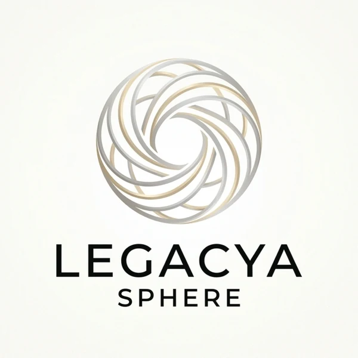

<div align="center">

<br />



<br /><br />

# Legacya Sphere · AI-Native Studio for Systems & Brand

### Business systems. Brand visuals. One AI-native studio.

*Websites, internal tools and AI automations, plus the campaign visuals that go with them.*

<br />

[](https://legacya-portofolio.vercel.app)
[](https://legacyasphere-id.github.io/Legacya-Portofolio/)
[](https://react.dev)
[](https://vitejs.dev)
[](https://tailwindcss.com)
[](https://www.typescriptlang.org)

<br />

</div>

---

## Overview

This is the studio website and portfolio for **Legacya Sphere**, the one-founder studio I run from Bekasi, Indonesia (Yoga Pratama Effendi).

I build business websites, internal tools and AI automations, and create the campaign visuals and short-form video that sell them. The site is written for business owners, not developers, so the copy stays in plain business language. Everything visitor-facing exists in **English and Indonesian**, with a toggle in the header.

The site is a static React single-page app with two pages: the **home page** (`/`) and a dedicated **Work page** (`/work`). There is no backend: project inquiries are composed in the browser and sent through WhatsApp or email.

---

## How the work is labeled

Every piece of work on the site says exactly what it is. This is the most important rule in the repo.

| Label | Where | Meaning |
|-------|-------|---------|
| **Self-initiated reference build · Live demo** | Showcase card and the detail panel on `/work` (`engagement: 'reference'`) | Systems I designed and built myself to show capability. Not client work. |
| **Concept work · not commissioned by the brand** | Showcase card and the Creative Work cards on `/work` (`engagement: 'concept'`) | Campaign studies made on my own initiative. Brand names shown belong to their owners. |
| **Training · Anthropic courses completed** | `FounderSection` | Course completion certificates from Anthropic Academy. Not professional certifications. |

There is currently no client work on the site.

### Feature flag

`SHOW_PRICING` in `src/core/identity.ts` gates the "Starting from" prices on the service cards in `SolutionsSection`. It stays `false` until the `TODO(yoga)` prices are real and approved.

Search the codebase for `TODO(yoga)` to find every missing fact.

### Copy and language rules

- Bilingual (`EN | ID`): every visitor-facing string lives in `src/i18n/en.ts` and `src/i18n/id.ts` (`export const id: Dictionary = ...`), so a missing translation fails the build. First visit uses `navigator.language` (`id*` starts in Bahasa Indonesia, otherwise English) and the choice is remembered in `localStorage` under `legacya-lang`. The choice carries across pages.
- First person singular ("I build", "Tell me about your business" / "Saya membangun", "Ceritakan tentang bisnismu"). It is one founder, not an agency "we" / "kami". Indonesian copy uses the approachable, professional "kamu" tone.
- No em dashes in customer-facing copy in either language.
- No technical jargon in customer-facing files. `npm test` (`src/core/inquiry.test.ts`) fails if words like PostgreSQL, Prisma, Supabase or JWT appear, or if an em dash slips in.
- Never invent client names, testimonials, metrics, prices or results.

---

## Pages and routing

There are two routes, handled by a small router built on the History API (`src/core/router.ts`). It has no dependency, so there is no routing library to maintain.

| Path | What it shows |
|------|---------------|
| `/` | The home page: Hero, About, Services, a **Work preview** with the showcase card and a "See all work" button, Process, AI Workflow, Why Legacya, Founder, the contact form, Footer |
| `/work` | The **Work page**: page header, the showcase card as project picker, the Digital Work detail panel, the Creative Work tabs and cards, and a closing line with a button to the contact form |

Any other path shows the home page.

**Deep links**
- `/work?project=<id>` opens `/work` with that digital project selected.
- `/work?creative=<id>` opens `/work` with that creative item's details popup.
- Home anchors keep working (`/#about`, `/#services`, `/#contact`). From `/work`, the nav links and the "Request Similar Work" buttons navigate back to the home page, scroll to the right section, and preselect the service in the contact form.

**Links** use the `<Link>` component (`src/components/Link.tsx`). It navigates without a page reload, but Ctrl, Cmd, Shift and middle-click still open a new tab.

**Hosting**
- Vercel rewrites every path to `index.html` (`vercel.json`), so `/work` works on a direct visit or reload.
- GitHub Pages serves the app under `/Legacya-Portofolio/`. The router reads `import.meta.env.BASE_URL`, and the build copies `index.html` to `404.html` so a deep link still loads the app. Pages answers such a link with HTTP 404 status but shows the right page.

---

## Website Structure

### Home page (`/`)

Composed in order by `src/App.tsx`:

| # | Section | Component | Description |
|---|---------|-----------|-------------|
| 0 | **Navigation** | `SiteNav`, `SectionGuide` | Fixed glass header with section links (About, Services, Work, Process, AI Workflow), the `EN \| ID` toggle, a "Start a Project" action, plus the side section guide |
| 1 | **Hero** | `HeroSection` | "Business systems. Brand visuals. One AI-native studio." with the "What do you need?" chooser chips |
| 2 | **About** | `StudioIntroSection` | Who the studio works with and how |
| 3 | **Services** | `SolutionsSection` | Three service pillars. Prices are hidden behind `SHOW_PRICING` |
| 4 | **Work preview** | `WorkSection` | The showcase card and a "See all work" button that opens `/work` |
| 5 | **Process** | `ProcessSection` | Five steps: Discover, Define, Create, Refine, Deliver |
| 6 | **AI Workflow** | `AIWorkflowSection` | How AI is used: brief to spec, AI drafts and I direct, human review gates, you own everything |
| 7 | **Why Legacya** | `WhyLegacyaSection` | Practical reasons to work with a one-founder studio across digital and creative |
| 8 | **Founder** | `FounderSection` | Founder profile, Anthropic training certificates, contact links |
| 9 | **Project Inquiry** | `CTASection` | Scope builder that composes a brief in the active language and sends it by WhatsApp or email |
| 10 | **Footer** | `Footer` | Navigation, "Inquire by Service" links and direct contact channels |

### Work page (`/work`)

| # | Part | Component | Description |
|---|------|-----------|-------------|
| 1 | **Page header** | `WorkPage` | Small label "Work", the one `<h1>` "Selected work", and a short sub line |
| 2 | **Showcase card** | `CurveShowcaseCard` | Two rows: four digital projects and six campaign studies. The center photo is sharp, the previous and next photos are blurred, and round buttons (or the side photos, or the arrow keys) change the active item |
| 3 | **Digital Work detail panel** | `WorkPage` (`#work-panel`) | The four self-initiated reference builds (InventoryOS, Talent Evaluation System, BrightPath Clinic, Legacya Restaurant & Kitchen System) with screenshots, build notes and live demo links |
| 4 | **Creative Work** | `CreativeWorkSection` (`#creative-work`) | Six concept campaign studies. It opens on the images; the films load only after the "Cinematic Video & Visual Production" tab is clicked, so no video loads on first visit |
| 5 | **Closing line** | `WorkPage` | "Tell me about your business." and a button to the contact form on the home page |

---

## Design System

A warm stone canvas paired with a deep architectural blue. Typography pairs **Instrument Serif** (h1 and h2 headings) with **Sora** (smaller headings and the wordmark), **Inter** (body copy) and **Geist Mono** (metadata and numbered labels). Tokens live in `src/index.css`. The showcase card has its own light styles (`.cs-*` classes in the same file).

| Token | Hex | Purpose |
|-------|-----|---------|
| `bg` | `#F5F0E8` | Warm stone page canvas |
| `surface` | `#FAF7F2` | Elevated cards and content containers |
| `raised` | `#F0EADF` | Subtle section and pill elevation |
| `border` | `#E5DDD0` | Hairline dividers, cards, inputs |
| `text` | `#181818` | Headlines and primary copy |
| `muted` | `#66625D` | Supporting descriptions |
| `dim` | `#9A958C` | Metadata and labels |
| `blue` | `#5E7EBE` | Secondary blue accent and highlights |
| `blue-deep` | `#2F4F7F` | Primary blue for actions, headlines and badges |
| `blue-dark` | `#26416B` | Hover state for deep blue |

All interactive elements are at least 44 px tall on phones, and body text is at least 16 px.

---

## Project Structure

```text
Legacya-Portofolio/
├── public/
│   ├── creative-work/            # Concept campaign visuals (.webp), posters and faststart MP4s
│   ├── assets/certificates/      # Anthropic Academy course certificates (.webp previews + .pdf)
│   ├── logos/                    # Tool logos (SVG), not used by the current site
│   ├── logo.png                  # Circular emblem (navbar, footer)
│   ├── img-04.webp               # Founder portrait, also the Open Graph image
│   ├── img-15.webp               # Full brand mark
│   └── img-16..23.webp           # Reference build screenshots
├── src/
│   ├── core/
│   │   ├── router.ts             # History API router, base-path helpers, useRoute()
│   │   ├── identity.ts           # Studio identity, contact channels, feature flags, navigation triggers
│   │   ├── site.ts               # SITE_URL and OG_IMAGE_URL used in index.html
│   │   ├── inquiry.ts            # Inquiry validation and WhatsApp/email brief composer
│   │   └── inquiry.test.ts       # Unit tests, router helper tests, i18n key parity and customer-facing copy audit
│   ├── i18n/
│   │   ├── en.ts                 # English visitor-facing dictionary (source of truth for the Dictionary type)
│   │   ├── id.ts                 # Indonesian visitor-facing dictionary ("saya" / "kamu" tone)
│   │   └── context.tsx           # LanguageProvider, useT() hook, localStorage and <html lang> sync
│   ├── data/
│   │   ├── projects.ts           # Digital work data (ids, images, links; text lives in i18n)
│   │   └── creativeWork.ts       # Concept campaign study data
│   ├── components/               # SiteNav, SectionGuide, Footer, Link, CurveShowcaseCard
│   ├── sections/                 # One file per page section (WorkSection.tsx also holds WorkPage)
│   ├── hooks/useScrollReveal.ts  # Reveal-on-scroll for [data-animate] elements
│   ├── types/project.ts          # Shared TypeScript interfaces
│   ├── utils/asset.ts            # BASE_URL-aware asset resolver for Vercel and GitHub Pages
│   ├── App.tsx                   # Picks the page for the current route, handles scroll and focus
│   ├── main.tsx                  # React entry point wrapped in LanguageProvider
│   └── index.css                 # Tailwind v4 theme tokens, component utilities and showcase card styles
├── tests/portfolio.spec.ts       # Playwright end-to-end tests (desktop + mobile, EN/ID, routing, showcase card)
├── index.html                    # Entry HTML with SEO, Open Graph, JSON-LD and the Vercel Analytics snippet
├── vite.config.ts                # Vite config: base path per target, %SITE_URL% injection, 404.html copy
├── playwright.config.ts          # E2E config (runs against `npm run preview`)
├── vercel.json                   # Vercel SPA routing and cache headers
└── .github/workflows/deploy.yml  # GitHub Actions validation and Pages deployment
```

---

## Getting Started

```bash
git clone https://github.com/legacyasphere-id/Legacya-Portofolio.git
cd Legacya-Portofolio

npm install           # install dependencies
npm run dev           # dev server on http://localhost:3000
npm run lint          # type-check (tsc --noEmit)
npm test              # unit tests and copy audit
npm run build         # production bundle into dist/
npm run test:e2e      # Playwright tests against a preview build (run `npm run build` first)
```

`playwright.config.ts` points `executablePath` at the Chromium bundled in the Claude Code cloud environment. On another machine, remove that line and run `npx playwright install chromium` once.

Before opening a pull request, run lint, unit tests, build and the end-to-end tests, and check the result at 390 px and 1440 px in both languages.

---

## Deployment

### Vercel (primary)
Build command: `npm run build` · Output directory: `dist`

### GitHub Pages (mirror)
`.github/workflows/deploy.yml` validates sources and media, runs `npm ci && npm run build`, and deploys `dist/` on every push to `main`. When `GITHUB_ACTIONS` is set, Vite builds with the base path `/Legacya-Portofolio/`.

### Analytics
Vercel Web Analytics is enabled in the Vercel project. A short script at the end of `index.html` loads `/_vercel/insights/script.js` only where it exists: it is skipped on `localhost` and on the GitHub Pages mirror. It needs no package and follows route changes, so `/work` visits are counted. Visitors with ad blockers are not counted.

### Notes
- Canonical, Open Graph and JSON-LD URLs come from `SITE_URL` in `src/core/site.ts`. It points at the Vercel address because there is no custom domain.
- Renaming the repository breaks the GitHub Pages base path. Update `base` in `vite.config.ts` and the workflow if you rename it.

---

## Author

**Yoga Pratama Effendi**
Founder · Legacya Sphere · Bekasi, Indonesia · GMT+7

[](https://github.com/legacyasphere-id)
[](mailto:legacyasphere@gmail.com)
[](https://www.linkedin.com/in/yoga-pratamaeffendi-59b376245)

---

## License

[MIT](LICENSE) for the code. Studio copy and visuals belong to Legacya Sphere. Brand names shown in concept work belong to their owners.
